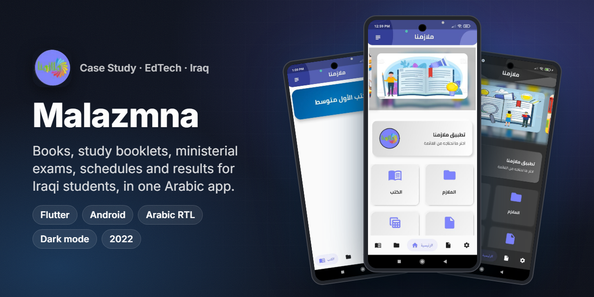
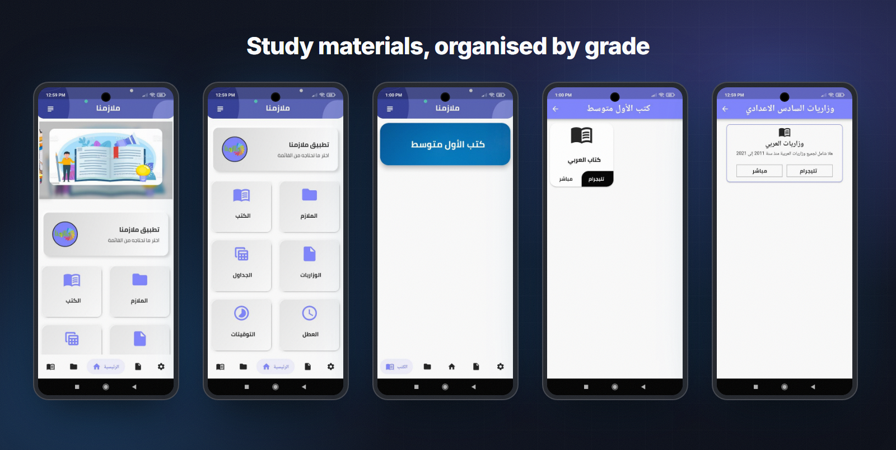
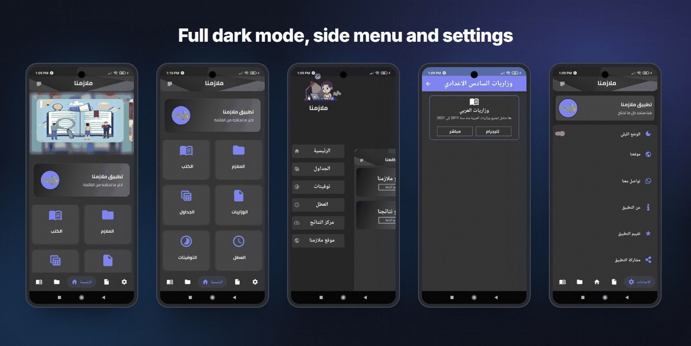
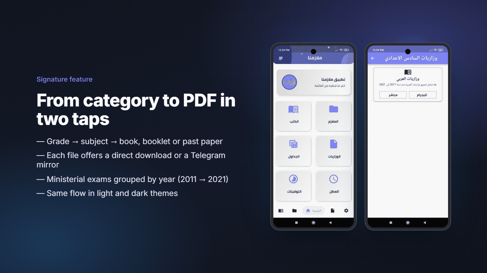
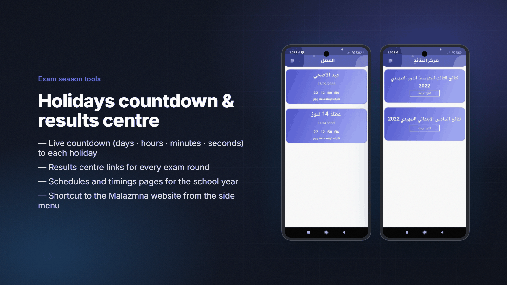
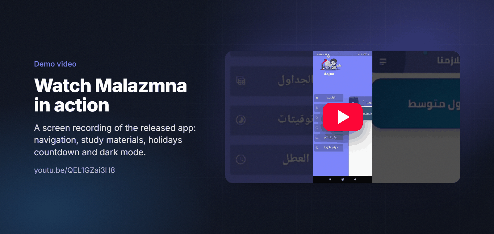
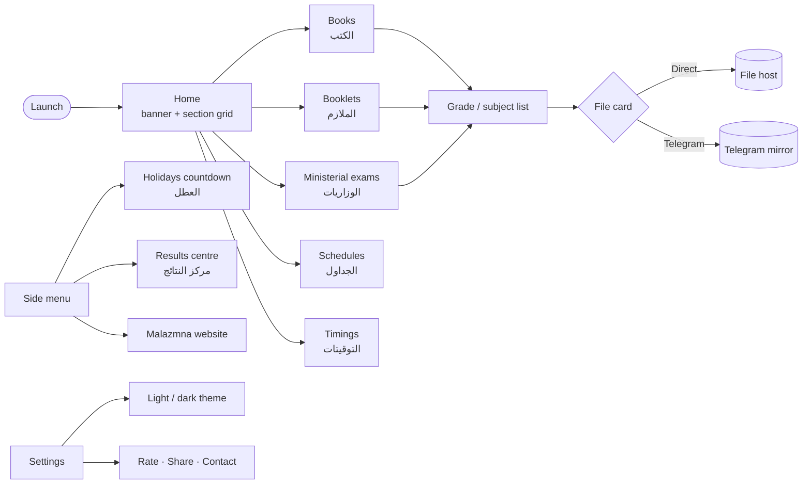

<h1 align="center">Malazmna</h1>

<b>Every book, study booklet and ministerial exam an Iraqi student needs, in one Arabic app.</b>

  
  
  
  
  
  

> ℹ️ Case study. The source code of this freelance project is not included (it is not in the author's archive), so this page documents only what the released app shows.

## Overview

**Malazmna** (ملازمنا, "our study booklets") is an Arabic education app for school students in **Iraq**.
It collects the material students look for during the school year in one place: official textbooks,
*malazem* (teacher-written study booklets), ministerial past papers, schedules, holiday dates and exam results.

| | |
|---|---|
| **Audience** | Iraqi intermediate (متوسط) and preparatory (اعدادي) students |
| **My role** | Freelance Flutter developer: built the Android app end to end |
| **Timeline** | Released in 2022 (demo shared in March 2022) |
| **Language** | Arabic, right to left, with light and dark themes |

## The challenge

- Study material was **spread across Telegram channels and websites**, so finding the right file for a specific grade and subject took time.
- A single download link is not always reachable, so students needed **more than one way to get each file**.
- During exam season students check the same things every day: **how many days are left until a holiday, and whether results are out**.

## Highlights

**📚 Study materials**
- Six sections on the home screen: books (الكتب), booklets (الملازم), schedules (الجداول), ministerial exams (الوزاريات), timings (التوقيتات) and holidays (العطل)
- Content is organised by grade, then by subject (for example *First Intermediate → Arabic textbook*)
- Every file offers **two download sources**: a direct link (مباشر) or a Telegram mirror (تليجرام)
- Ministerial past papers are grouped per subject, for example Arabic papers from 2011 to 2021

**⏳ Exam season tools**
- Holidays screen with a live countdown (days, hours, minutes, seconds) to each upcoming holiday
- Results centre (مركز النتائج) with a link for each exam round, for example Third Intermediate and Sixth Primary 2022

**🎨 Experience**
- Fully Arabic RTL interface with a bottom navigation bar and a side menu
- Light and dark themes that you can switch from Settings
- Settings: dark mode, our website, contact us, about the app, rate the app, share the app

## Screens

Home, categories, a grade's books, a book with direct and Telegram download, ministerial exams.

The same flows in dark mode, plus the side menu and settings.

## Signature feature

The main job of the app is to get the student to the right PDF fast. From the home grid the student picks a section
(books, booklets, ministerial exams), then a grade, then the file. Each file card has two buttons:

1. **مباشر (Direct)**: opens the file straight from its host.
2. **تليجرام (Telegram)**: opens the same file in the Telegram channel where it is mirrored. This helps when the direct host is slow or blocked.

## Demo video

## Product architecture

The source code is not available, so this diagram shows the **navigation and feature structure** you can see in the
released app, not the internal code layers.

| Layer | What the released app shows |
|---|---|
| Client | Flutter app for Android, Material components |
| Navigation | Bottom navigation bar (5 tabs) and a side drawer |
| Theming | Light and dark themes, switched at runtime from Settings |
| Localisation | Arabic RTL layout |
| Content delivery | External links to PDF files, with a direct host and a Telegram mirror |
| Time-based UI | Countdown timers (days, hours, minutes, seconds) for holiday dates |

## Engineering notes

- **Two download sources per file.** Each file card has a direct link and a Telegram mirror, so students can use whichever source works on their network.
- **RTL first.** All screens, cards and the drawer are built for Arabic right-to-left reading. Two-button rows, back arrows and icons follow the RTL direction.
- **Theme parity.** The study flow, the side menu and settings all have matching light and dark versions (see the screenshots above).
- **Live countdown.** Each holiday card counts down to a fixed date, down to the second.

## Results

- Shipped as an Android app for Iraqi students in 2022, with a public demo video ([YouTube](https://youtu.be/QEL1GZai3H8)).
- No public store statistics are available for this project, so none are claimed here.

## بالعربي

**ملازمنا** تطبيق تعليمي عربي لطلاب المدارس في العراق. يجمع الكتب المنهجية والملازم والأسئلة الوزارية والجداول في مكان واحد.
كل ملف متاح بطريقتين: تحميل مباشر أو من قناة تليجرام، حتى يختار الطالب الأسرع على شبكته.
فيه كمان عدّاد تنازلي للعطل ومركز للنتائج، وواجهة عربية كاملة بوضع فاتح وداكن.
اشتغلت على المشروع كمطوّر Flutter مستقل، وبنيت تطبيق أندرويد من أوله لآخره سنة 2022.

## Links

- 🎬 Demo video: <https://youtu.be/QEL1GZai3H8>

---
<h3 align="center">Built by Mahmoud Shaker — Senior Flutter Engineer</h3>

  
  
  
  
  
  
  

